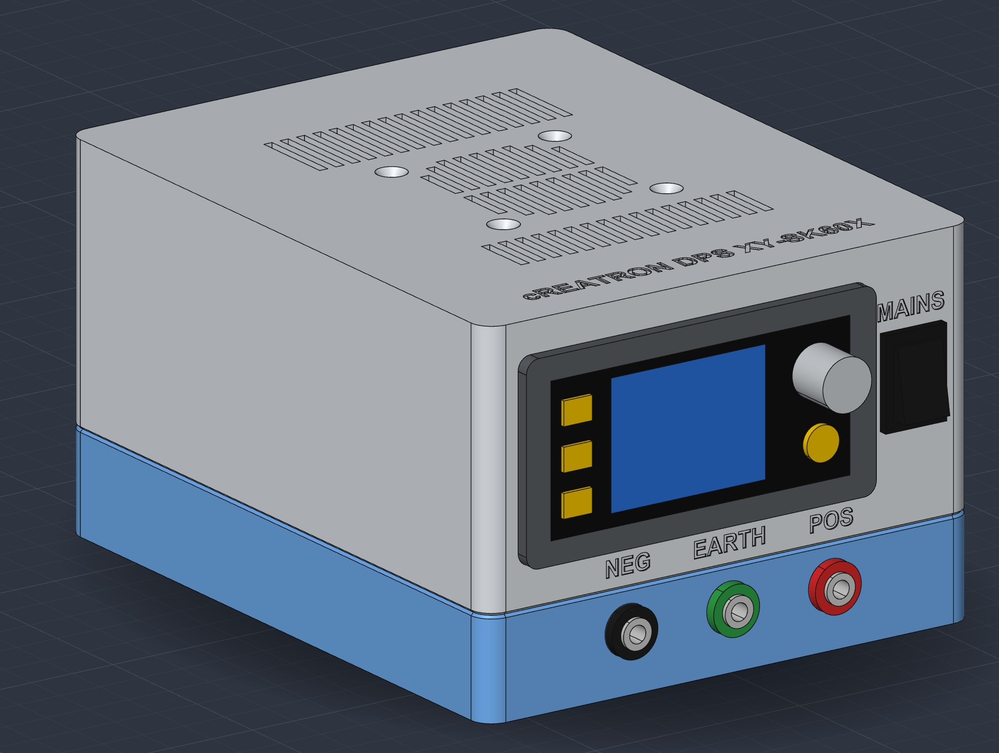
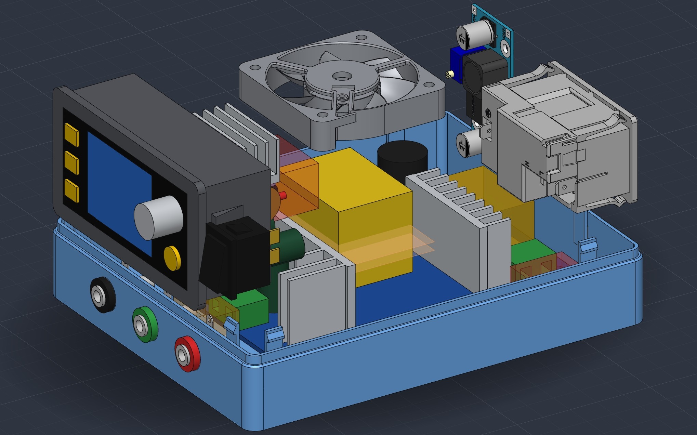
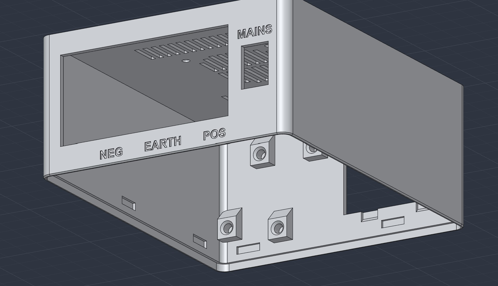
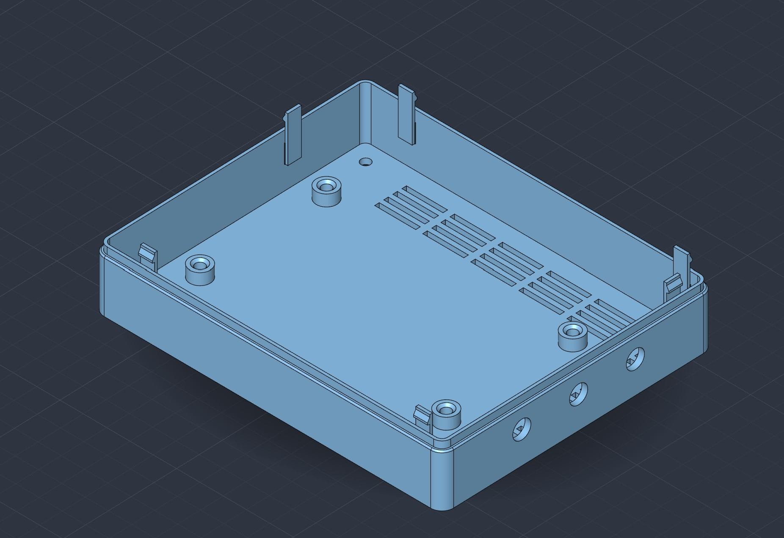
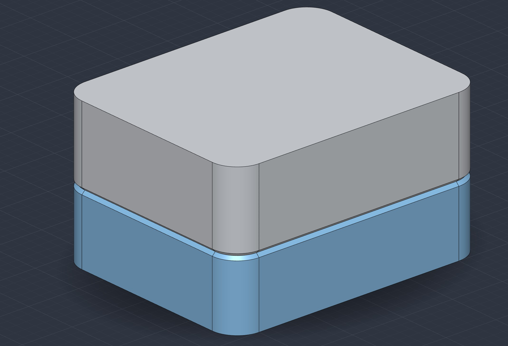
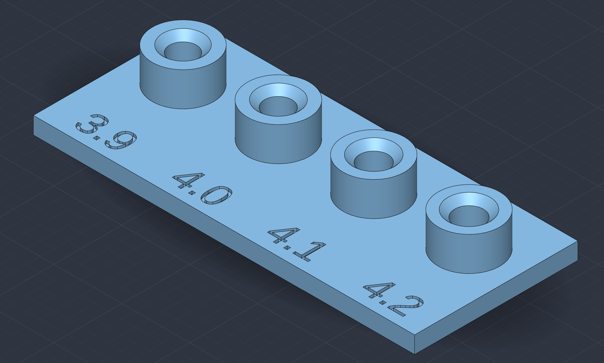

# 36 V Bench Power Supply Enclosure

A 3D-printed enclosure for a 36 V / 5 A bench power supply, modelled in SolidCraft.
Inside: an AC-DC2416 open-frame supply, an XY-SK60 controller with display, a front mains rocker switch, a Schurter C14 inlet with fuse and switch, three 4 mm banana sockets, and a 5 V fan powered by an LM2596HV buck module.

**Size:** 120 × 150 × 85 mm. It prints in two halves that snap together with 6 clips and need no screws.

The full design specification is in **[spec.md](spec.md)**: dimensions, positions, wiring, clearances and open items.

| Inside | Top half (lid down) | Bottom half |
|---|---|---|
|  |  |  |

Test prints, to run before the full enclosure:

| Clip test box (`clipTest.sc`) | Insert test (`insertTest.sc`) |
|---|---|
|  |  |

## Files

| File | What it is |
|---|---|
| `PSU_Enclosure_120x85.sc` | **Main design.** Enclosure plus all components, parametric |
| `parameters.csv` | Parameter table exported from the main design (name, unit, expression, value, comment) |
| `Enclosure_Top.3mf`, `Enclosure_Bottom.3mf` | Print-ready halves, exported from the main design |
| `insertTest.sc`, `insertTest.3mf` | Four test standoffs with Ø3.9 / 4.0 / 4.1 / 4.2 holes (1 mm lead-in chamfer) for the M3 heat-set inserts used in the PSU and LM2596 mounts |
| `clipTest.sc`, `clipTest_Top.3mf`, `clipTest_Bottom.3mf` | 40 × 50 × 28 test box with the same wall, lip, seam and 6 snap clips as the main design (split at Z 13); print it to tune the clips first |
| `AC-DC2416.sc` | AC-DC supply model (board, heatsinks, terminals, wiring keep-out spaces) |
| `XY-SK60.sc` | Controller model (bezel, body, tabs, heatsink, rear connectors) |
| `C14_Schurter_KM00-1205-11.sc` | IEC inlet, imported from the vendor STEP |
| `Rocker_Switch_KCD1-101.sc` | Mains rocker switch KCD1-101, from the datasheet (used) |
| `Rocker_Switch_15x21.sc` | Rocker switch modelled from measurements, 15 × 21 flange (not used) |
| `Rocker_Switch.sc` | Smaller rocker switch, first guess (not used) |
| `Banana_4mm_Black/Red/Green.sc` | 4 mm banana sockets (ST-351B), own parametric model with the plastic split either side of the panel (used) |
| `iec-v14-wide.sc` | Earlier sketch of a Qualtek 764-00/002 inlet (not used) |
| `iec-c14-17361.sc`, `iec-c14-17362.sc`, `iec-c14-352181.sc` | Alternative IEC C14 inlets imported from vendor STEP files (sources in `stepFiles/IEC-C14_*.stp`); not used |
| `backup/PSU_Enclosure2.sc`, `backup/PSU_Enclosure_110x80.sc` | Two early designs kept for history (not used). Other old versions (layout v2, 110 × 85, pre-parametric 120 × 85) are only in git history |
| `pictures/` | Renders of the assembled enclosure, the inside, the two halves and the two test prints (shown above) |
| `stepFiles/` | Vendor STEP sources (fan, LM2596, IEC C14 inlets, banana socket); already embedded in the `.sc` files, kept for re-import |

## Printing

| Part | Orientation |
|---|---|
| `Enclosure_Bottom.3mf` | Upright, so the clip arms print vertically and can flex |
| `Enclosure_Top.3mf` | Upside down, lid on the bed |

- **Test the clips first:** print `clipTest_Bottom.3mf` and `clipTest_Top.3mf` (a 40 × 50 × 28 box with the same lip, seam and 6 clips) in the same orientations. If the clips are too stiff or too loose, adjust `clip_hook`, `clip_arm_t` or the `clip_pocket_*` values in `clipTest.sc`, reprint, then copy the values into the main design. See [spec.md §2.3a](spec.md#23a-clip-test-box-cliptestsc).
- **Test the insert holes:** print `insertTest.3mf` and press an M3 heat-set insert into each of the four holes (Ø3.9–4.2). Use the size that works for `psu_boss_hole` and `lm_boss_hole` (now 4.2, the size that tested best). See [spec.md §2.3b](spec.md#23b-insert-test-inserttestsc).
- **Material:** PETG, or ASA for more heat margin.
- **Settings:** 2.5 mm walls; no supports needed.

## Assembly notes

- **Fan supply:** set the LM2596HV output to **5.0 V** before connecting the fan.
- **Mains switching:** the front rocker switches the mains, and the IEC module's switch on the back also works.
- **Earth:** bond the green ⏚ banana to mains earth (PE).
- **Wire slack:** wires cross the split at Z 23, so leave enough slack to open the case.
- **Mains safety:** the AC-DC2416 is open-frame, so the inside is **live when plugged in**. Build and test with mains-safety precautions.

## Editing the design

- **Parameters:** open `PSU_Enclosure_120x85.sc` in SolidCraft. The main parameters (`enc_w`, `enc_d`, `enc_h`, `ctl_z`, `slot_bridge`, …) are listed in [spec.md §7](spec.md#7-parameters-main-ones-in-psu_enclosure_120x85sc).
- **Changing the box size:** change `enc_w`, `enc_d`, `enc_h` (and `split_z`, `wall`, `corner_r` if needed). The shell, lip, groove, seam, clips, vents, feet and standoffs follow. The imported components (PSU, controller, rocker, IEC inlet, bananas, fan, LM2596) are placed by fixed transforms, so move them to the new walls by hand afterwards (see [spec.md §7](spec.md#7-parameters-psu_enclosure_120x85sc)).

## Credits

The models of the fan (Pelonis, via TraceParts), the LM2596 module, the ST-351B banana socket and the Schurter inlet come from their makers' or contributors' STEP files and remain theirs. Check their licences before publishing this repository.
